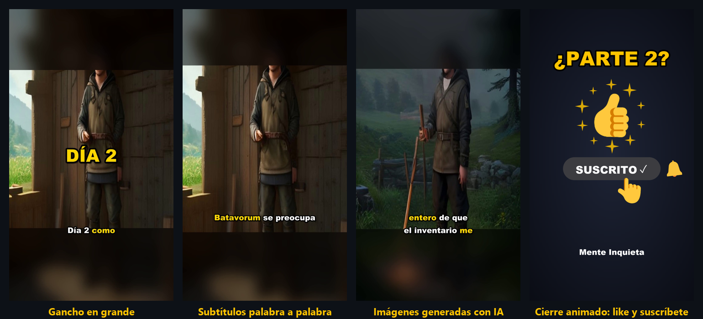
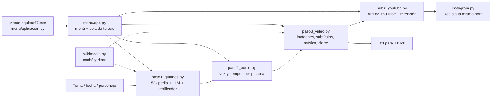

<p align="center"></p>

# MenteInquieta67 (pipeline-curiosidades)

**De un tema a un vídeo publicado en YouTube (Shorts verticales y vídeos largos explicados con dibujos), con IA y sin
inventarse la historia.**

Escribes un tema («La caída de Constantinopla»), una fecha o un personaje, y el programa genera un vídeo de
40-45 segundos para Shorts / TikTok / Reels: guion verificado contra Wikipedia, voz, clips de vídeo e imágenes de
archivo, subtítulos animados, música, miniatura, textos para publicar… y lo sube programado a YouTube (y, si quieres,
a Instagram como Reel). Todo se maneja desde un menú que se abre como aplicación de escritorio.

<p align="center"></p>

## Qué hace

| Paso | Qué ocurre |
|---|---|
| **1 · Guion** | Busca el material en Wikipedia y un LLM (Groq) escribe un guion de 40-45 s en 5-6 escenas, con gancho en la primera frase, pregunta final, tono musical y nombre corto. Un **segundo LLM verifica cada frase contra la fuente** y marca las que no tienen respaldo. |
| **2 · Voz** | Cada escena se convierte en voz neuronal (edge-tts) con la duración y el tiempo **de cada palabra**. |
| **3 · Vídeo** | Primero, 1-2 clips de vídeo de archivo con licencia libre que una IA comprueba que encajan con la escena y la época; después, imágenes reales de Wikipedia, Wikimedia Commons, The Met y el Art Institute of Chicago (dominio público), con zoom lento, subtítulos palabra a palabra, gancho en grande, música que baja sola cuando habla la voz y una toma final animada de «like y suscríbete». |
| **4 · Publicar** | Sube a YouTube por la API oficial (título, descripción, etiquetas, aviso de contenido sintético, publicación programada), publica el Reel en Instagram a la misma hora (Graph API) y prepara el texto de TikTok y el comentario para fijar. |
| **5 · Medir** | Trae de YouTube las vistas y la **retención** de cada vídeo (cuánta gente se queda frente a la que desliza y qué parte ve) para saber qué funciona. |

**Formatos:** tema libre, **series** de varias partes con índice previo (para que no se repitan ni destripen el final),
**efemérides** («tal día como hoy»), **«Diario de…»** (humor histórico en primera persona con imágenes generadas por IA)
**actualidad** (noticias recientes contrastadas en varios medios, con las fuentes citadas y la fecha de los datos) y
**vídeo con IA**: la app escribe los prompts de cada escena para una IA de vídeo (Veo, Sora, Runway, Kling) y monta los
clips que generas con ella.

**Vídeos largos:** de unos 10 minutos, horizontales y por capítulos, al estilo «X en 10 minutos». Las escenas no usan
fotos: las dibuja la propia app en SVG con un estilo de rotulador (el narrador Bonesy, vestido según la época del tema, mapas de España y del mundo con
las zonas de colores, calendarios, cifras, personajes y líneas de tiempo), y cada elemento aparece cuando la voz lo
nombra. El guion se revisa escena a escena en el menú antes de dibujarlo, y solo se rehace lo que cambia. Cada vídeo
largo sale con tres miniaturas para probar, una pantalla final y tres Shorts verticales que llevan a él.

**Asistente:** un chat dentro del menú al que le pides lo que quieras con tus palabras; entiende qué vídeo es
(Short, serie, efemérides, diario, vídeo largo o actualidad), lo propone y lo lanza con un clic. Usa una IA local con
Ollama si está instalada y, si no, Groq.

**Para crecer:** el menú enseña el **camino a monetizar** (suscriptores, horas de vídeos largos y vistas de Shorts
frente a lo que pide YouTube, al ritmo actual) y mete cada vídeo en su lista de reproducción.

## Decisiones técnicas

Lo interesante del proyecto no es llamar a un LLM, sino todo lo que hace falta alrededor para que el resultado sea
**fiable, barato y publicable**:

- **Que la IA no se invente datos.** El guion solo puede usar hechos del material descargado (*grounding*), y un
  segundo modelo actúa de verificador (*LLM-as-a-judge*) frase a frase. En el formato de humor, el verificador
  distingue los chistes de las afirmaciones históricas. Las dudas se muestran en el menú junto a las fuentes.
- **Revisión humana donde importa.** Solo se publican guiones verificados; si el verificador marca dudas, el vídeo se
  sube en privado. Cada vídeo se declara a YouTube como contenido sintético.
- **Cupos gratuitos de los LLM.** Groq limita los tokens por día *y por modelo*: si el principal se agota, el programa
  pasa a modelos de reserva y apunta hasta cuándo no reintentar, en vez de quedarse esperando.
- **Ser un buen cliente de las APIs.** Un módulo común ([`wikimedia.py`](scripts/wikimedia.py)) da a todas las peticiones
  caché en disco, ritmo máximo por servidor (compartido entre procesos), respeto a `Retry-After`/`maxlag` e
  identificación con contacto, como exige Wikimedia. Esto acabó con los bloqueos temporales.
- **Hechos para retener.** 40-45 s, gancho comprobado por código (se rechazan saludos, fechas sueltas y arranques de
  enciclopedia), pregunta final para los comentarios, series cuyas partes se entienden solas y efemérides elegidas
  dando más peso a lo que funciona en el canal (España, mundo hispano, personajes famosos).
- **Elegir imágenes que encajen.** Puntuación por palabras clave ponderadas por rareza (tipo IDF), penalización de
  imágenes de otra época y umbral mínimo: mejor repetir una imagen buena que poner una irrelevante. Los clips de vídeo
  van primero y los valida un LLM (*LLM-as-a-judge*) para que no entre un vídeo de otra época o de otro suceso. Se
  pueden cambiar a mano desde el menú.
- **Rehacer en segundos.** Cada escena es un segmento en caché identificado por una huella de sus entradas; las
  escenas se montan en paralelo y se unen sin recodificar. Un vídeo nuevo tarda ~1 min y rehacerlo tras cambiar una
  imagen, ~8 s (antes, ~3 min).
- **Licencias.** Solo imágenes con licencia libre o de dominio público, con los créditos generados automáticamente;
  música sintetizada por el propio programa (sin derechos de autor).

## Arquitectura



| Archivo | Función |
|---|---|
| [`paso1_guiones.py`](scripts/paso1_guiones.py) | Material de Wikipedia, guion con el LLM, índice de series, verificador, modelos de reserva |
| [`paso2_audio.py`](scripts/paso2_audio.py) | Voz por escena con tiempos por palabra; solo regenera las escenas cambiadas |
| [`paso3_video.py`](scripts/paso3_video.py) | Selección de imágenes, composición vertical, subtítulos ASS, segmentos en caché, música, miniatura, textos |
| [`cierre.py`](scripts/cierre.py) | Animación final de «like y suscríbete» dibujada fotograma a fotograma |
| [`wikimedia.py`](scripts/wikimedia.py) | Acceso a Wikipedia, Commons y museos: caché, límites, esperas |
| [`imagenes_ia.py`](scripts/imagenes_ia.py) | Imágenes generadas con IA para el formato «Diario de…» |
| [`musica.py`](scripts/musica.py) | Pistas de fondo sintetizadas con ffmpeg (épica, misterio, triste, neutra, cómica) |
| [`subir_youtube.py`](scripts/subir_youtube.py) | OAuth y subida a YouTube, programación, descripción del canal, vistas y retención (YouTube Analytics) |
| [`instagram.py`](scripts/instagram.py) | Conexión con Instagram (Graph API) y publicación de cada vídeo como Reel |
| [`video_ia.py`](scripts/video_ia.py) | Formato «Vídeo con IA»: IAs de vídeo, prompts por escena y clips subidos |
| [`video_largo.py`](scripts/video_largo.py) | Vídeos largos: índice y capítulos con el LLM, voz, dibujos, montaje por escenas en caché, miniatura y capítulos de YouTube |
| [`asistente.py`](scripts/asistente.py) | Asistente del menú: entiende lo que se le pide (Ollama en local o Groq) y lo convierte en una acción |
| [`shorts_largo.py`](scripts/shorts_largo.py) | Shorts verticales sacados de un vídeo largo (fragmentos elegidos por el LLM, subtítulos ASS) |
| [`dibujos.py`](scripts/dibujos.py) | Escenas dibujadas en SVG (Bonesy, mapas, fechas, cifras, personajes…) y su captura con Edge (Playwright) |
| [`actualidad.py`](scripts/actualidad.py) | Noticias recientes (Bing Noticias y, con clave, Tavily) y su texto, para los vídeos de actualidad |
| [`radar.py`](scripts/radar.py) | Elige la noticia de la que más se habla hoy en España (tendencias de Google y Bing Noticias) |
| [`piloto_actualidad.py`](scripts/piloto_actualidad.py) | Hace y publica solo el vídeo de la noticia del día, con salvaguarda |
| [`borrar.py`](scripts/borrar.py) | Borra un vídeo y todo lo generado para él (a la Papelera de reciclaje) |
| [`horarios.py`](scripts/horarios.py) | Horas recomendadas para publicar según el tipo de vídeo (efeméride, serie, humor…) |
| [`programados.py`](scripts/programados.py) | Cola de publicaciones programadas: sube cada vídeo antes de su hora sin pasarse del límite diario y lo publica en Instagram a su hora |
| [`menu/`](menu/) | Menú (Flask): Crear, Mis vídeos (por revisar, listos, programados, publicados), Programados con calendario y Ajustes |
| [`menu/aplicacion.py`](menu/aplicacion.py) | Abre el menú como aplicación de escritorio, en su propia ventana (pywebview) |
| [`lanzador/`](lanzador/) | Lanzador `MenteInquieta67.exe` (C#), que abre la aplicación sin consola |

## Tecnologías

Python · Groq (gpt-oss-120b / gpt-oss-20b / Qwen) · Wikipedia y Wikimedia API · The Met y Art Institute of Chicago
APIs · edge-tts · ffmpeg (zoompan, subtítulos ASS, sidechain) · Pillow · Flask · pywebview (WebView2) · C# ·
YouTube Data API v3 y YouTube Analytics API (OAuth 2.0) · Instagram Graph API · Tavily · Playwright (Edge) · SVG ·
Natural Earth · Ollama

## Instalación

Requisitos: Windows y Python 3.11 o superior (ffmpeg viene incluido con `imageio-ffmpeg`).

```bash
python -m venv .venv
.venv\Scripts\activate
pip install -r requirements.txt
copy .env.example .env      # y pon tu clave gratuita de Groq (console.groq.com/keys)
```

Abre el menú como aplicación de escritorio, en su propia ventana: `pythonw menu\aplicacion.py`, o crea el
lanzador `MenteInquieta67.exe` con `lanzador\crear_exe.bat`. También funciona en el navegador con
`menu\Abrir menu.bat`. Después, sigue la ayuda integrada.
Para subir a YouTube hace falta crear unas credenciales OAuth en Google Cloud: la guía está en
[`menu/LEEME.txt`](menu/LEEME.txt) y en el propio menú (Ajustes → YouTube).

También se puede usar por línea de comandos:

```bash
python scripts/paso1_guiones.py --tema "La caída de Constantinopla" --partes 3
python scripts/paso2_audio.py
python scripts/paso3_video.py
python scripts/subir_youtube.py <guion> --privacidad private --publicar-el 2026-10-25T20:00
```

## Limitaciones conocidas

- Las imágenes de IA gratuitas (Pollinations) tienen calidad irregular, marca de agua y límite de 1 imagen / 45 s.
- edge-tts usa un servicio no oficial de Microsoft: para un canal monetizado convendría una voz con licencia comercial.
- YouTube deja en privado lo que sube un proyecto de Google Cloud sin auditar, aunque esté programado.
- La subida de los programados usa el Programador de tareas de Windows (una tarea que se reprograma sola).
- El verificador reduce mucho los errores, pero no es infalible: los vídeos deben revisarse antes de publicarse.

## Cómo se ha desarrollado

El proyecto se ha construido en *pair programming* con un asistente de IA (Claude Code, de Anthropic): yo definía
qué necesitaba el canal, probaba cada versión, detectaba lo que fallaba en la práctica (datos inventados, bloqueos de
APIs, imágenes que no encajaban, cupos agotados…) y decidía las prioridades; el asistente proponía e implementaba
las soluciones. Ha sido una forma de aprender cómo se lleva un sistema basado en LLM de la demo a algo que funciona
de verdad.

## Novedades

Los cambios de cada versión están en [CHANGELOG.md](CHANGELOG.md). La última, **2.0.0**, renombra la aplicación a
MenteInquieta67 y añade el camino a monetizar, los Shorts sacados de los vídeos largos, las tres miniaturas, la
pantalla final y las listas de reproducción automáticas.

## Licencia

[MIT](LICENSE). Las imágenes que descarga el programa tienen sus propias licencias (se citan en cada vídeo).
